# aico: the McSparrow AI company

A Claude Code plugin that runs a small software company. You are the **CEO**. A **Lead** (Project Manager) routes work to 32 **Role** agents. Each Role starts with a fresh context and passes its work on through **Handoff** files. You approve at three **Gates**: Brief, Plan and Ship. Terms are defined in `GLOSSARY.md`; decisions are in `docs/adr/`.

**New here?** The full user guide is in [`documentation/`](documentation/README.md): getting started, every command, all 32 Roles, and the concepts the company runs on.

## Install
```
/plugin marketplace add therealmcsparrow/McAICompany
/plugin install aico@aico
/aico:setup                 # standalone skills: hallmark, find-skills, humanizer, impeccable, …
/aico:setup go react        # optional stack groups: go, react, tanstack, auth
```
`superpowers` and `mattpocock-skills` install automatically as plugin dependencies.
The repo is private: your git must be able to clone it (e.g. `gh auth login`). Update later with `/plugin marketplace update aico`.

## Use
| Command | What it does |
|---|---|
| `/aico:lead <request>` | Front door. Picks the Roles and the route, then runs it |
| `/aico:triage <request>` | Classifies a request by size, risk and type and recommends the shortest valid route before you commit to a Playbook |
| `/aico:feature <desc>` | Brief → Plan (Core + Contracts) → build per Module → review, QA, security → Ship |
| `/aico:fix <bug>` | QA reproduces → engineer fixes test-first → review → Ship |
| `/aico:launch <product>` | Positioning, copy, release notes, privacy/terms → Ship |
| `/aico:audit [scope]` | Read-only quality, test, security and license report |
| `/aico:research <topic\|project\|file> [quick\|deep]` | Before you build: the market, tech and (for UI work) design researchers look it up online, in parallel. You get one sourced report with a verdict, ranked actions and low-hanging fruit. You then pick: feature, brainstorm, roadmap or park. Nothing is built |
| `/aico:client intake\|handoff` | Client brief, estimate and proposal, or the client handoff package |
| `/aico:usability-test <target> [real-users]` | Every Persona tests in parallel (walkthrough, hands-on, accessibility) → one report |
| `/aico:feedback <source>` | Turns user feedback, reviews and support reports into ranked fix and feature proposals you pick from |
| `/aico:incident <what broke>` | Mitigate, check EU reporting duties, fix, then write the postmortem. Urgency allowed; the Ship Gate stays |
| `/aico:refactor <scope>` | Restructures existing code toward Core, Modules and Contracts in safe slices, no behavior change |
| `/aico:maintain` | Routine upkeep: dependencies, vulnerabilities, licenses, CI health and stale rules, then the upgrades you pick |
| `/aico:brainstorm <idea\|file>` | The relevant Roles weigh in on your idea, round after round, until you say done. Each round ends with a digest and a short question form; then you choose: plan and implement, roadmap, nice to have, or park |
| `/aico:cooler [topic] [turns=N\|listen]` | Random colleagues chat at the water cooler about the project, unmoderated; others walk up or leave. Recorded in `.company/cooler/`, nothing built |
| `/aico:standards [tool\|refresh]` | The Senior Engineer researches or refreshes sourced best-practice rules for the stack; the Architect signs off; exceptions come to you |
| `/aico:pentest <target> [full]` | On demand: the Pentester attacks a local/staging build of **your own** product like a red team, proves findings safely (`full` = real exploit chains), and reports them ranked. No code changes |
| `/aico:help [command]` | Lists every command, or explains one: its options, their effect, and what it does. `/aico:<command> help` shows the same |
| `/aico:version` | Shows which aico version is installed and its latest changelog entry |
| `/aico:language [<tag> [project] \| clear [project]]` | Shows or sets the language aico writes in (reports, forms, Handoff prose). Your default applies everywhere; `project` overrides it for one product. Machine-read parts stay English |
| `/aico:vulnscan` | On demand: the Vulnerability Scanner checks your dependencies and code against CVE/NVD, OSV, GitHub Advisories and CISA KEV; Critical/High come to you, safe fixes come as a ready upgrade set |
| `/aico:settings` | Opens a local page to set each Role's name, model and effort, the language and profile, the pipeline (Fix rounds, parallel or sequential, optional lanes) and the Gates, as your default or per project. Nothing changes until you save |

You can also ask for any Role directly, e.g. "use the aico security agent on src/auth".

## Company hierarchy
Reporting lines show who signs off; the Lead dispatches every Role.

```mermaid
flowchart TD
  CEO["CEO (you)"] --> Lead["Lead (Project Manager)"]
  Lead --> Product
  Lead --> Eng["Engineering"]
  Lead --> Design["Design & Art"]
  Lead --> Quality["Quality & Security"]
  Lead --> MTR["Market & tech research"]
  Lead --> Research["User research & testing"]
  Lead --> Content["Content & Growth"]
  Lead --> Support
  Lead --> Legal
  Product --> PM["product-manager"] & AM["account-manager"]
  Eng --> Arch["architect (CTO)"]
  Arch --> SE["senior-engineer"] & BE["backend-engineer"] & FE["frontend-engineer"] & DE["desktop-engineer"] & AI["ai-data-engineer"] & GE["game-engineer"] & DO["devops"]
  Design --> UX["ui-ux-designer"] & BA["brand-artist"] & MA["motion-artist"] & GA["game-artist"] & PA["prompt-artist"]
  Quality --> CR["code-reviewer"] & QA["qa"] & SEC["security"] & PEN["pentester (on demand)"] & VSC["vuln-scanner (on demand)"]
  MTR --> MR["market-researcher"] & TR["tech-researcher"] & DR["design-researcher"]
  Research --> UR["ux-researcher"] & PT["persona-tester"] & HT["hands-on-tester"] & AT["accessibility-tester"]
  Content --> WR["writer"] & MK["marketer"] & LO["localizer"]
  Support --> SU["support"]
  Legal --> LG["legal"]
```



## Roles
| Opus | Sonnet | Haiku |
|---|---|---|
| architect, senior-engineer, code-reviewer, security, pentester, product-manager, tech-researcher | account-manager, marketer, writer, support, legal, backend-, frontend-, desktop-, game-, ai-data-engineer, devops, ui-ux-designer, qa, brand-, motion-, game-artist, persona-, hands-on-, accessibility-tester, ux-researcher, market-researcher, design-researcher, vuln-scanner | localizer, prompt-artist |

Each Role has a person name (for example Ava for the architect), shown next to the Role in Handoffs, Gates and help. Change names, models and effort in `/aico:settings`.

Each Role also sets an `effort` level. **High:** architect, code-reviewer, security, pentester, where a miss is expensive. **Low:** writing, art, lookup and support Roles. **Medium:** everyone else. See the roster in `docs/spec.md`.

Code-reviewer, security, pentester, vuln-scanner, senior-engineer, legal, PM, account manager, support and all three researchers never edit source. Researchers write only their own Handoff and never install anything. The pentester and vuln-scanner run on demand only (`/aico:pentest`, `/aico:vulnscan`); the pentester attacks only the company's own local/staging builds, with authorization, and never runs destructive or persistent payloads. The localizer edits only string resource files. The architect writes only ADRs and Contract definitions (interfaces/schemas); its ruleset sign-off goes in its Handoff. The senior-engineer writes only rule packs and the ruleset. QA edits tests only. Testers never edit; hands-on- and accessibility-tester use your browser/computer-use tools.

## Rules everything follows
- **Core + Modules + Contracts** for every product: backend, frontend, desktop and game. Only CEO-approved items go in Core (`skills/contracts`).
- **Ruleset** (`aico:ruleset`): sourced Must/Should/May rules per tool, kept by the Senior Engineer. Security is law. Builders follow the rules before review; a Must exception needs your approval.
- **Fix rounds:** at most 2 by default (0–5 in `/aico:settings`), then escalation to you. Nits never loop.
- **Handoff Contract** (`aico:handoff`): Roles pass work through machine-readable Handoff fields (`base-commit`, `risk-tier`, `acceptance-ids`, `files-touched`) with a `contract|spec|security|test` blocking taxonomy; independent Steps run in parallel by default, and reviewers diff only against `base-commit`. From v1.1 the code-reviewer and compliance Steps also write a top block and `ID | file:line | problem | why | fix` rows.
- **Token cost:** a max context per Role in `/aico:settings` (default 150000, minimum 60000, handover at 80%), and a counts-only token ledger with one cost line at Ship. Savings come from reading less; caching gives none.
- **Lessons:** a Ship appends up to 3 one-line Lessons to `.company/lessons.md`; later runs read it and pass the relevant ones to each Role.
- **EU compliance** (`aico:eu-compliance`): GDPR, CRA, AI Act Art. 50, EAA, VAT and consumer law are checked before Ship.
- **Git:** branch `aico/<task>`, one commit per Step, no push before the Ship Gate (an unlocked auto Ship Gate pushes and opens a PR, never merges). Commit subjects are `<type>: <summary>` (`feat`, `fix`, `test`, `docs`, `refactor`, `chore`), never prefixed with `aico` or a Role name.
- **Ideas:** brainstorms live in `.company/brainstorms/` as `YYYY-MM-DD HH.MM - Topic.md`, then move to `.company/roadmap/`, `nice-to-have/` or `parked/`. Cooler chats are recorded in `.company/cooler/` as `YYYYMMDD-HHMM-topic.md`.
- **Per product repo:** `.company/project.md` (product type, stack, voice, license, approved Core) and `.company/work/<task>/NN-<role>.md` Handoffs.

## Customize
- Company facts and the three Voice presets (clear, bold, technical): `company/PROFILE.md`
- Missing stack skills: `find-skills`, then add a group to `deps/skills.json`.
- Language aico writes in: `/aico:language` sets your default; `/aico:language <tag> project` overrides it for one product (`aico_language:` in `.company/project.md`). Product UI strings follow `languages:` instead.
- Rule library shared by all projects on this machine: `~/.mcsparrow/standards/` (make it a git repo to sync it). Each product commits copies of the packs it uses in `.company/standards/`.

## Maintain
```
npm test        # checker and installer tests
npm run check   # frontmatter, broken aico: refs; warns when agents > 50 or skills > 125 lines
```
Pressure-test evidence: `tests/pressure/RESULTS.md`.
