# aico: the McSparrow AI company

A Claude Code plugin that runs a small software company. You are the **CEO**. A **Lead** (Project Manager) routes work to 34 **Role** agents. Each Role starts with a fresh context and passes its work on through **Handoff** files. You approve at three **Gates**: Brief, Plan and Ship. Terms are defined in `GLOSSARY.md`; decisions are in `docs/adr/`.

**New here?** The full user guide is in [`documentation/`](documentation/README.md): getting started, every command, all 34 Roles, and the concepts the company runs on.

## Install
**Before you start**
- Claude Code.
- Git access to the private repo: your git must be able to clone it (for example, run `gh auth login` once).
- Node.js 24 or newer (`engines` in `package.json`, `.nvmrc`), for the helper scripts such as `scripts/settings.mjs`.
- Optional: `uv`, only for `/aico:skillspector`. aico never installs it for you.

**Steps** (in Claude Code)
1. Add the marketplace and install the plugin:
   ```
   /plugin marketplace add therealmcsparrow/McAICompany
   /plugin install aico@aico
   ```
   `superpowers` and `mattpocock-skills` install automatically as plugin dependencies.
2. Optional: install the standalone and stack skills the Roles use:
   ```
   /aico:setup                 # standalone skills: hallmark, find-skills, humanizer, impeccable, …
   /aico:setup go react        # optional stack groups: go, react, tanstack, auth
   ```
3. Check it worked: `/aico:version` shows the installed version and its latest changelog entry. `/aico:help` lists every command.

**Update:** `/plugin marketplace update aico`, then `/reload-plugins`. Run `/aico:version` to confirm.

**Uninstall:** `claude plugin uninstall aico@aico` in a terminal (or `/plugin` in Claude Code). Skills added by `/aico:setup` or a skill pick are not removed with it; see `documentation/commands.md` for their removal commands.

Details: [`documentation/getting-started.md`](documentation/getting-started.md).

## Use
| Command | What it does |
|---|---|
| `/aico:lead <request>` | Front door. Picks the Roles and the route, then runs it |
| `/aico:triage <request>` | Classifies a request by size, risk and type and recommends the shortest valid route before you commit to a Playbook |
| `/aico:reprompt <prompt>` | Turns a rough prompt into a complete one. It never runs it; you choose Use it, Edit, Keep only or Stop |
| `/aico:feature <desc>` | Brief → Plan (Core + Contracts) → build per Module → review, QA, security → Ship |
| `/aico:fix <bug>` | QA reproduces → engineer fixes test-first → review → Ship |
| `/aico:launch <product>` | Positioning, copy, release notes, privacy/terms → Ship |
| `/aico:audit [scope]` | Read-only quality, test, security and license report |
| `/aico:research <topic\|project\|file> [quick\|deep]` | Before you build: the market, tech and (for UI work) design researchers look it up online, in parallel. You get one sourced report with a verdict, ranked actions and low-hanging fruit. You then pick: feature, brainstorm, roadmap or park. Nothing is built |
| `/aico:client intake\|handoff` | Client brief, estimate and proposal, or the client handoff package |
| `/aico:usability-test <target> [real-users]` | Every Persona tests in parallel (walkthrough, hands-on, accessibility) → one report |
| `/aico:feedback <source>` | Turns user feedback, reviews and support reports into ranked fix and feature proposals you pick from |
| `/aico:incident <what broke>` | Mitigate, check EU reporting duties, fix, then write the postmortem. Urgency allowed; the Ship Gate stays |
| `/aico:refactor <scope>` | Restructures existing code toward Core, Modules and Contracts in safe slices, no behavior change |
| `/aico:maintain` | Routine upkeep: dependencies, vulnerabilities, licenses, CI health and stale rules, then the upgrades you pick |
| `/aico:brainstorm <idea\|file>` | The relevant Roles weigh in on your idea, round after round, until you say done. Replies are short (about 100 words). Each round ends with a digest and a short question form, and answered questions are not asked again; then you choose: plan and implement, roadmap, nice to have, or park |
| `/aico:cooler [topic] [turns=N\|listen]` | Random colleagues chat at the water cooler about the project, unmoderated; others walk up or leave. Recorded in `.company/cooler/`, nothing built |
| `/aico:standards [tool\|refresh]` | The Senior Engineer researches or refreshes sourced best-practice rules for the stack; the Architect signs off; exceptions come to you |
| `/aico:pentest <target> [full]` | On demand: the Pentester attacks a local/staging build of **your own** product like a red team, proves findings safely (`full` = real exploit chains), and reports them ranked. No code changes |
| `/aico:help [command]` | Lists every command, or explains one: its options, their effect, and what it does. `/aico:<command> help` shows the same |
| `/aico:version` | Shows which aico version is installed and its latest changelog entry |
| `/aico:language [<tag> [project] \| clear [project]]` | Shows or sets the language aico writes in (reports, forms, Handoff prose). Your default applies everywhere; `project` overrides it for one product. Machine-read parts stay English |
| `/aico:vulnscan` | On demand: the Vulnerability Scanner checks your dependencies and code against CVE/NVD, OSV, GitHub Advisories and CISA KEV; Critical/High come to you, safe fixes come as a ready upgrade set |
| `/aico:skillspector [--project\|--global\|--all\|<skill-name>] [--no-llm\|--claude-cli] [install]` | On demand: scans the agent skills installed in this project or your user folder with NVIDIA SkillSpector (pinned v2.13.1) and reports pass, findings or error per skill. Read-only; it suggests removals and runs none. The install changes your user-scope Claude config, so it always asks first |
| `/aico:settings` | Opens a local page to set each Role's name, model, effort and personality, the language and profile, the pipeline (Fix rounds, parallel or sequential, optional lanes) and the Gates, as your default or per project. Nothing changes until you save |
| `/aico:setup [core] [research] [go] [react] [tanstack] [auth] [type]` | Installs the standalone and stack skills. With `type` (or no arguments) it also sets the project's company type and offers a search for up to 5 skills that fit it. Nothing installs without your answer |

The next four commands belong to the non-software company types (see Customize). In a software company they are refused.

| Command | What it does |
|---|---|
| `/aico:report <question\|file> [quick\|deep]` | Research company: a client question becomes a sourced report. A Plan Gate approves the outline, questions and sources before research starts. The editor checks that every claim is cited `[S#]` or marked `(unverified)`, and Ship is blocked until it passes |
| `/aico:campaign <goal\|brief>` | Marketing company: a multi-channel campaign with copy, images and storyboards. A Plan Gate approves positioning, channels and deliverables first. Checks claims, AI disclosure, asset licences, the legal lane (testimonials, ad labels, price and green claims, comparison limits) and accessibility before the Ship Gate |
| `/aico:content <topic\|brief\|draft>` | Marketing company: one piece of content with sources and disclosures. A Plan Gate approves the outline first; the same checks as a campaign run before the Ship Gate |
| `/aico:design <brief\|project\|file>` | Design company: brief, research, concepts, critique and testing, ending in a design handoff package (files, specs, tokens, asset licence record) |

You can also ask for any Role directly, e.g. "use the aico security agent on src/auth".

## Settings
Run `/aico:settings`. It opens a local page (127.0.0.1) in your browser. Nothing changes until you save.

- **Tabs:** Roles (name, model, effort, context cap), Personality (one collapsible card per Role, with a filter by name, Role or department), Language & profile, Pipeline (Fix rounds, dispatch, review format, optional lanes), Gates, Skill scan, Mods.
- **New look.** The page has a new layout with clearer tabs, tables and controls, and colours for both light and dark mode. The tabs and what each setting does are as before.
- **User default or project override.** A project value wins over your user value, which wins over the plugin default.
  - User default, all projects: `~/.mcsparrow/config.json`, key `aico_settings` (or under `MCSPARROW_HOME` if set). Other keys in that file are kept.
  - Project override: `.company/settings.json` in the product repo, holding `{ "aico_settings": … }`.
- **Locks.** `gates.ship`, `gates.installs` and the `security` and `compliance` lanes stay on `ask` / on unless you unlock them at the user level. A project cannot unlock what you locked; its `unlocked` list is ignored. `skillspector.mode: claude_cli` and `mods.reflect.mode: model` count only at user level. The page shows a lock and its reason.
- **When it applies.** A run reads the settings once at its start, so a change applies from the next run. The mods re-read them each turn.
- **See what is in effect:** from the product repo, run `node "<plugin root>/scripts/settings.mjs" get`. It prints the resolved JSON, including `ignored` and `warnings`; `get <key>` prints one value, for example `get pipeline.fix_rounds`. The plugin root is the installed version's folder, such as `~/.claude/plugins/cache/aico/aico/0.12.0`.
- **Reset:** a key that is absent at a level counts as not set, so the level below applies. To reset a project, remove the key (or delete `.company/settings.json`). To reset your default, remove the key from `aico_settings` in `~/.mcsparrow/config.json`. An invalid value is refused on save and nothing is written.

Language has its own command: `/aico:language`. Full rules and every key: [`docs/contracts/aico-settings.md`](docs/contracts/aico-settings.md); user guide: [`documentation/concepts.md`](documentation/concepts.md#settings).

## Company hierarchy
Reporting lines show who signs off; the Lead dispatches every Role.

```mermaid
flowchart TD
  CEO["CEO (you)"] --> Lead["Lead (Project Manager)"]
  Lead --> Product
  Lead --> Eng["Engineering"]
  Lead --> Design["Design & Art"]
  Lead --> Quality["Quality & Security"]
  Lead --> MTR["Market & tech research"]
  Lead --> Research["User research & testing"]
  Lead --> Content["Content & Growth"]
  Lead --> Support
  Lead --> Legal
  Product --> PM["product-manager"] & AM["account-manager"] & RP["reprompter"]
  Eng --> Arch["architect (CTO)"]
  Arch --> SE["senior-engineer"] & BE["backend-engineer"] & FE["frontend-engineer"] & DE["desktop-engineer"] & AI["ai-data-engineer"] & GE["game-engineer"] & DO["devops"]
  Design --> UX["ui-ux-designer"] & BA["brand-artist"] & MA["motion-artist"] & GA["game-artist"] & PA["prompt-artist"]
  Quality --> CR["code-reviewer"] & QA["qa"] & SEC["security"] & PEN["pentester (on demand)"] & VSC["vuln-scanner (on demand)"]
  MTR --> MR["market-researcher"] & TR["tech-researcher"] & DR["design-researcher"] & SR["skill-researcher"]
  Research --> UR["ux-researcher"] & PT["persona-tester"] & HT["hands-on-tester"] & AT["accessibility-tester"]
  Content --> WR["writer"] & MK["marketer"] & LO["localizer"] & ED["editor"]
  Support --> SU["support"]
  Legal --> LG["legal"]
```



## Roles
| Opus | Sonnet | Haiku |
|---|---|---|
| architect, senior-engineer, code-reviewer, security, pentester, product-manager, tech-researcher | account-manager, marketer, writer, editor, reprompter, support, legal, backend-, frontend-, desktop-, game-, ai-data-engineer, devops, ui-ux-designer, qa, brand-, motion-, game-artist, persona-, hands-on-, accessibility-tester, ux-researcher, market-researcher, design-researcher, skill-researcher, vuln-scanner | localizer, prompt-artist |

Each Role has a person name (for example Ava for the architect), shown next to the Role in Handoffs, Gates and help. Change names, models and effort in `/aico:settings`.

Each Role also sets an `effort` level. **High:** architect, code-reviewer, security, pentester, where a miss is expensive. **Low:** writing, art, lookup and support Roles. **Medium:** everyone else. See the roster in `docs/spec.md`.

Code-reviewer, security, pentester, vuln-scanner, senior-engineer, legal, PM, account manager, support and all four researchers never edit source. Researchers write only their own Handoff and never install anything. The pentester and vuln-scanner run on demand only (`/aico:pentest`, `/aico:vulnscan`); the skill-researcher has no Bash and never runs or installs a skill (the Lead scans each candidate in a quarantine folder); the pentester attacks only the company's own local/staging builds, with authorization, and never runs destructive or persistent payloads. The editor has no Bash and no web access and only blocks: it never rewrites a claim. The localizer edits only string resource files. The architect writes only ADRs and Contract definitions (interfaces/schemas); its ruleset sign-off goes in its Handoff. The senior-engineer writes only rule packs and the ruleset. QA edits tests only. Testers never edit; hands-on- and accessibility-tester use your browser/computer-use tools.

## Rules everything follows
- **Core + Modules + Contracts** for every product: backend, frontend, desktop and game. Only CEO-approved items go in Core (`skills/contracts`).
- **Ruleset** (`aico:ruleset`): sourced Must/Should/May rules per tool, kept by the Senior Engineer. Security is law. Builders follow the rules before review; a Must exception needs your approval.
- **Fix rounds:** at most 2 by default (0–5 in `/aico:settings`), then escalation to you. Nits never loop.
- **Handoff Contract** (`aico:handoff`): Roles pass work through machine-readable Handoff fields (`base-commit`, `risk-tier`, `acceptance-ids`, `files-touched`) with a `contract|spec|security|test` blocking taxonomy; independent Steps run in parallel by default, and reviewers diff only against `base-commit`. From v1.1 the code-reviewer and compliance Steps also write a top block and `ID | file:line | problem | why | fix` rows.
- **Token cost:** a max context per Role in `/aico:settings` (default 150000, minimum 60000, handover at 80%), and a counts-only token ledger with one cost line at Ship. Savings come from reading less; no saving percentage is claimed yet.
- **Lessons:** a Ship appends up to 3 one-line Lessons to `.company/lessons.md`; later runs read it and pass the relevant ones to each Role.
- **EU compliance** (`aico:eu-compliance`): GDPR, CRA, AI Act Art. 50, EAA, VAT and consumer law are checked before Ship.
- **Git:** branch `aico/<task>`, one commit per Step, no push before the Ship Gate (an unlocked auto Ship Gate pushes and opens a PR, never merges). Commit subjects are `<type>: <summary>` (`feat`, `fix`, `test`, `docs`, `refactor`, `chore`), never prefixed with `aico` or a Role name.
- **Ideas:** brainstorms live in `.company/brainstorms/` as `YYYY-MM-DD HH.MM - Topic.md`, then move to `.company/roadmap/`, `nice-to-have/` or `parked/`. Cooler chats are recorded in `.company/cooler/` as `YYYYMMDD-HHMM-topic.md`.
- **Per product repo:** `.company/project.md` (product type, stack, voice, license, approved Core) and `.company/work/<task>/NN-<role>.md` Handoffs.

## Customize
- Company facts and the three Voice presets (clear, bold, technical): `company/PROFILE.md`
- Missing stack skills: `find-skills`, then add a group to `deps/skills.json`.
- Skill picks: the skill-researcher (Selin) finds and vets third-party skills for your stack, product type or company type, and the Lead scans every pick before you see it. You approve the set, then confirm the exact install commands in a second form. The install pins the scanned commit, and a bad scan after the install stops the run. Approved skills go in the `## Skills` section of `.company/project.md` (design skills stay in `## Design skills`). Scan mode (`no-llm` or `claude_cli`) is in `/aico:settings` (Skill scan tab). Both modes send package names, versions and ecosystems to OSV.dev for a vulnerability lookup, plus the ids of any vulnerabilities found; `claude_cli` also sends skill text to Anthropic.
- Company type: one per project, set with `/aico:setup` and saved as `company_type:` in `.company/project.md`. `software` is the default and works as before. `research` (Research consultancy), `marketing` (Marketing and content agency) and `design` (Design studio) each have their own Roles and Playbooks and their own meaning of "ship". For these three the Ship Gate summary starts with `Ship means: …`, and checks such as `claims-cited` (every claim cited or marked unverified, checked by the editor) must pass first. A passed check records that Legal stated its position; it is a process check, not legal advice or a compliance certificate, so have a qualified lawyer review before you publish. Switching a type later is not supported. Details: `documentation/concepts.md#company-types`.
- Personalities: every Role has a personality (temperament, way of talking, pet topic, and an Intelligence and a Creativity level of low, medium or high) that is social-only style data and only colours its voice in `/aico:cooler` chats and `/aico:brainstorm` rounds. Change it in `/aico:settings` (Personality tab), as your default or per project. A project value counts, and is passed only as quoted style data. A personality never changes a model, a verdict, a review, a Gate or any other dispatch. Details: `documentation/concepts.md#personalities`.
- Language aico writes in: `/aico:language` sets your default; `/aico:language <tag> project` overrides it for one product (`aico_language:` in `.company/project.md`). Product UI strings follow `languages:` instead.
- Mods: four add-ons that show run progress (Savvy, with a Gates bar and a Steps bar in text, such as `Gates 1/3 [###-----] last: brief`), cost and the Lead's cache clock (Cache Tax), suggested Lessons (Reflect), and check risky `git commit`s before they run (Blast Radius). All on by default; switch them in `/aico:settings`. Terminal is proven, desktop is unverified. Blast Radius only sees commits Claude makes through its Bash and PowerShell tools, not `!git commit`, another terminal or an IDE. See `documentation/mods.md`.
- Rule library shared by all projects on this machine: `~/.mcsparrow/standards/` (make it a git repo to sync it). Each product commits copies of the packs it uses in `.company/standards/`.

## Maintain
```
npm test        # checker and installer tests
npm run check   # frontmatter, broken aico: refs; warns when agents > 50 or skills > 125 lines
```
Pressure-test evidence: `tests/pressure/RESULTS.md`.
